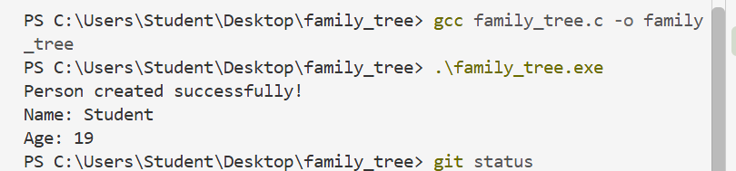
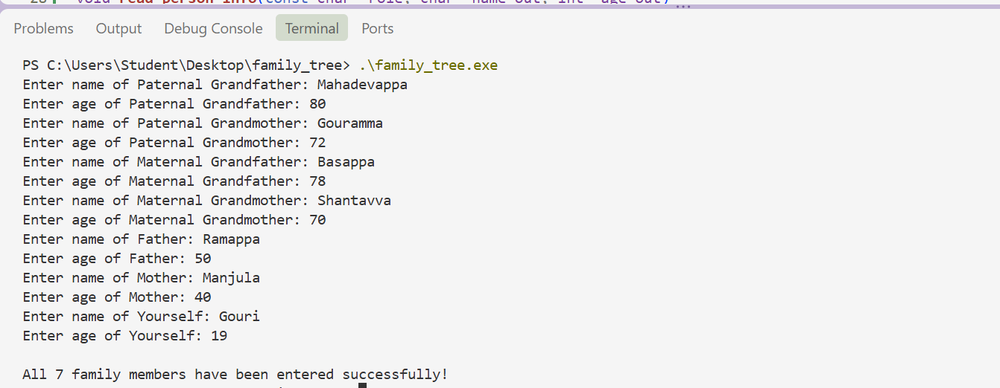
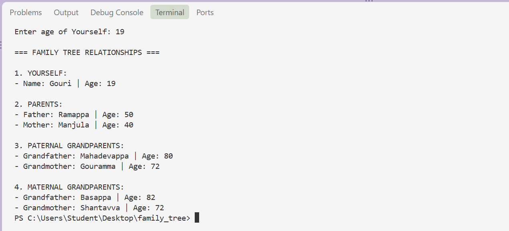
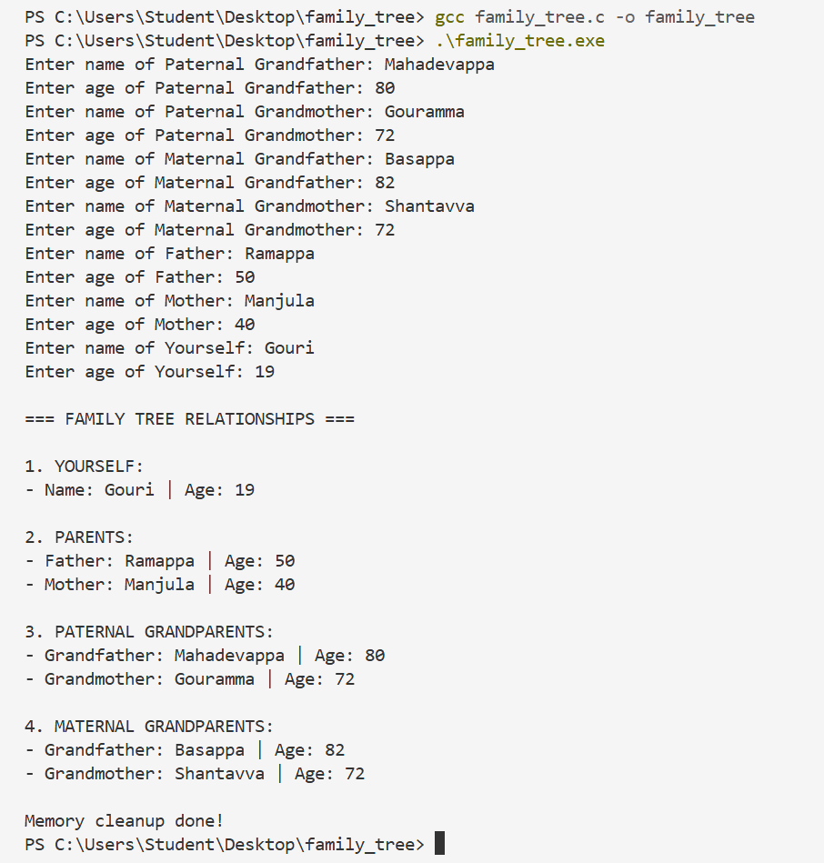

# Family Tree Project in C

## About the Project
This project is a C program that creates and displays a three-generation family tree.

It stores information about seven family members:
- Paternal Grandfather
- Paternal Grandmother
- Maternal Grandfather
- Maternal Grandmother
- Father
- Mother
- Myself
The program uses structures and pointers to connect the family members.
## Features
- Takes the name and age of seven family members as input.
- Uses a Person structure to store information.
- Connects family members using pointers.
- Displays parents and grandparents.
- Uses malloc() for memory allocation.
- Uses free() for memory cleanup.
## How to Compile

```bash
gcc family_tree.c -o family_tree

## Program Output

The screenshots of the output of the Family Tree program.







